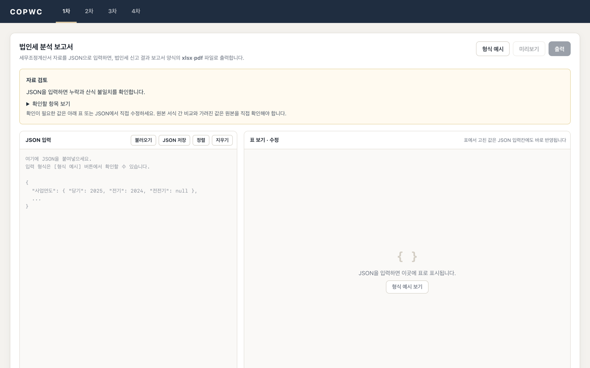
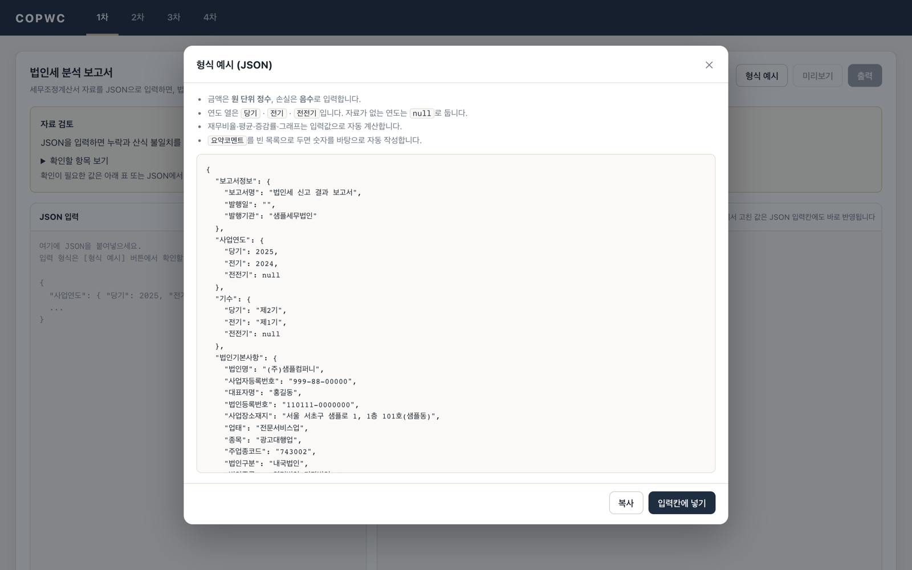
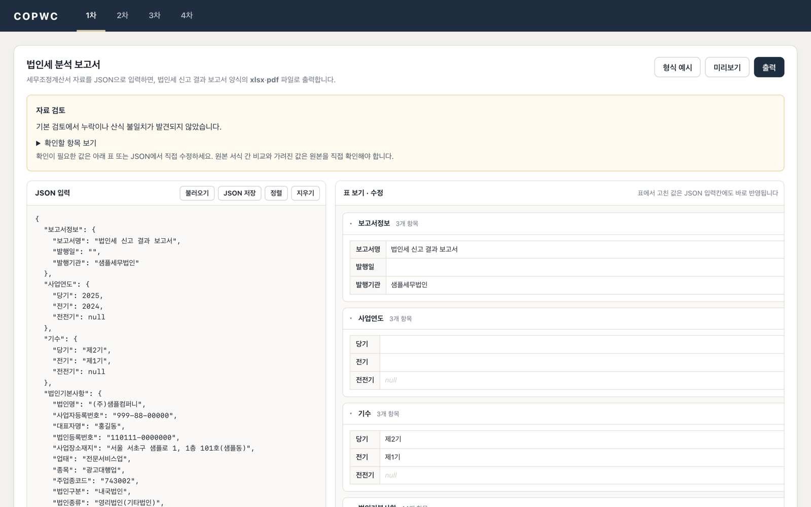
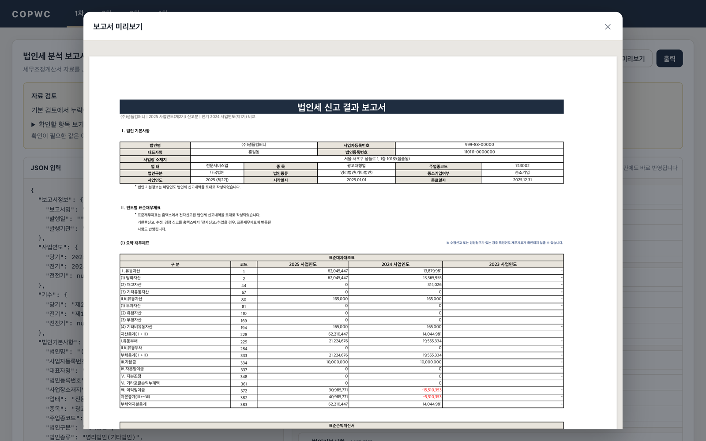
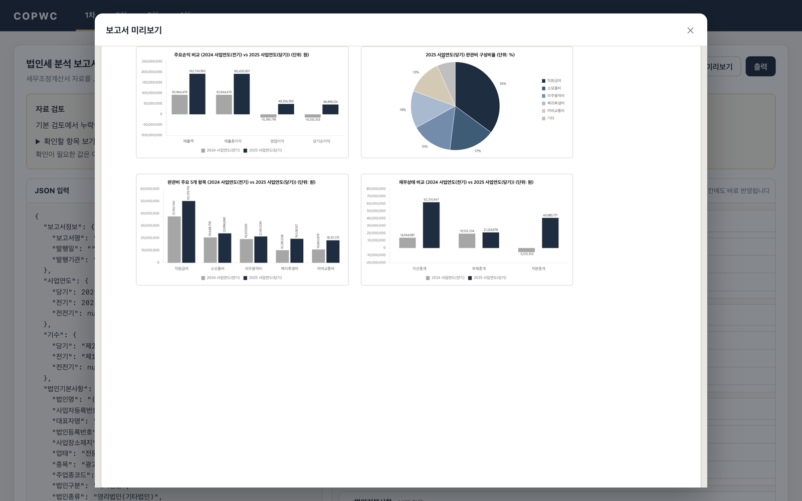
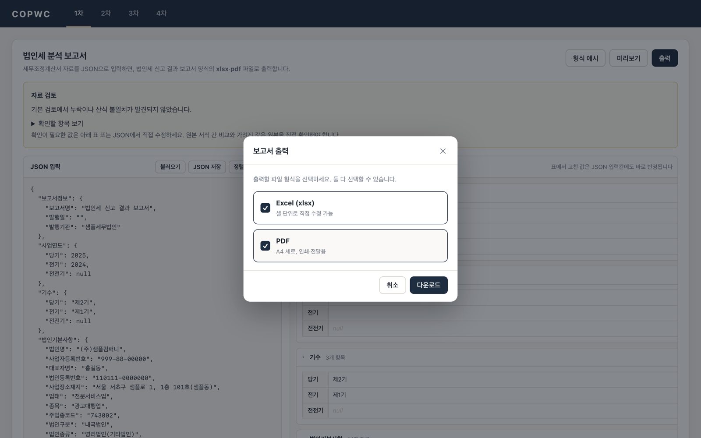
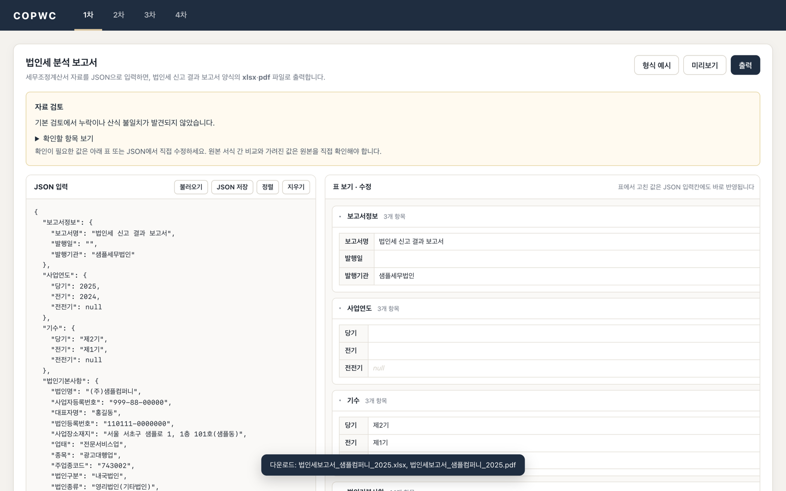
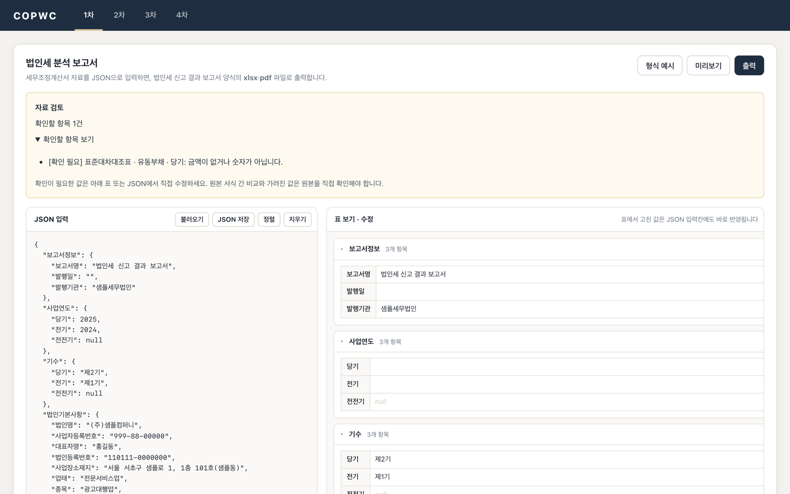
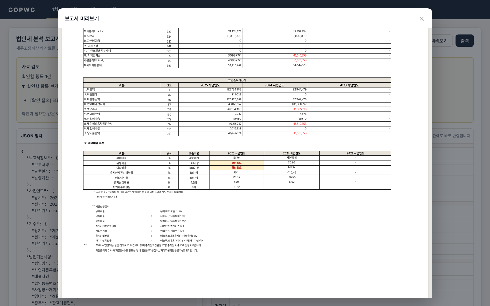

# COPWC — 법인세 신고 결과 보고서 생성기

세무조정계산서에서 뽑은 값을 JSON으로 넣으면, 세무법인이 쓰는 **법인세 신고 결과 보고서 양식(xlsx·pdf)** 을 자동으로 만들어 주는 웹 도구입니다.
재무비율·증감률·그래프·요약 코멘트는 입력값에서 자동 계산하고, 숫자가 비었거나 이상한 칸은 0으로 메우지 않고 「확인 필요」로 표시합니다.

**🔗 데모: https://copwc-tax-report.web.app** (설치 없이 브라우저에서 바로 사용 · 모든 처리는 브라우저 안에서만 이뤄지고 서버로 데이터를 보내지 않음)

> 화면의 회사·숫자는 모두 가상의 샘플 데이터입니다.

## 사용 흐름

### 1. 시작 화면

JSON 입력칸(왼쪽)과 표 보기·수정(오른쪽)으로 구성됩니다. 상단 「자료 검토」 박스가 입력값의 누락·산식 불일치를 실시간으로 알려 줍니다.



### 2. 형식 예시 불러오기

「형식 예시」 버튼을 누르면 입력 규칙과 샘플 JSON이 나옵니다. 「입력칸에 넣기」로 바로 채울 수 있습니다.



### 3. 입력 확인·수정

JSON이 표로 펼쳐집니다. 표에서 값을 고치면 JSON에도 바로 반영되고, 반대도 마찬가지입니다. 입력은 브라우저에 저장돼 새로고침해도 유지됩니다.



### 4. 미리보기

「미리보기」는 실제 출력될 보고서를 A4 페이지 그대로 보여 줍니다. 엑셀 템플릿의 인쇄 설정(A4 세로, 너비 1페이지 맞춤, 페이지 나눔)을 그대로 따릅니다.



손익·판관비·재무상태 그래프 4종도 입력값에서 자동으로 그려집니다.



### 5. 출력 (xlsx · pdf)

「출력」에서 형식을 고르고 다운로드합니다. 둘 다 고를 수 있습니다. xlsx는 수식이 살아 있어 셀 단위로 고칠 수 있고, pdf는 전달·인쇄용입니다.





### 6. 값이 이상할 때: 「확인 필요」

예를 들어 `표준대차대조표.유동부채.당기`를 숫자 대신 `"확인 필요"`로 두면, 자료 검토 박스가 해당 위치를 짚어 줍니다.



보고서에서도 0으로 계산하지 않고, 그 값에 의존하는 **유동비율·당좌비율만** 노란 음영의 「확인 필요」로 멈춥니다. 나머지 비율은 정상 계산됩니다.



## 기술 스택

Vite · Vanilla JS · ExcelJS(엑셀 템플릿 채우기) · Chart.js(그래프) · pdf-lib(PDF) · Firebase Hosting(배포)

## 실행

```bash
npm install
npm run dev      # http://localhost:5173
npm run build    # dist/ 정적 빌드
```

## 1차 페이지

- **법인세 분석 보고서** (위): JSON 입력 → 표 보기·수정 → xlsx / pdf 출력 (둘 다 선택 가능)
  - [형식 예시] 팝업: 입력 JSON 예시 (샘플컴퍼니 2025 당기 / 2024 전기)
  - 출력 양식: `1차/1차_자료/법인세보고서_출력예시.xlsx` (Ⅰ~Ⅴ) + 요구사항정리 T-02의 Ⅵ~Ⅷ
  - Ⅳ-(1) 부가가치세, Ⅳ-(2) 원천징수는 Q-07에 따라 제외 (Ⅳ-(3)~(8) 번호는 출력예시 그대로 유지)
  - xlsx·pdf·미리보기는 모두 **같은 워크북**에서 만듦: 출력예시.xlsx 템플릿(`public/report-template.xlsx`)을 복사해 값을 채우고(`workbook.js`),
    PDF는 그 시트를 Excel 인쇄 설정(A4 세로, 너비 1페이지 맞춤, 페이지 나눔)대로 그린 페이지를 담음(`sheetHtml.js`)
  - 금액 칸에 숫자가 아닌 값(예: `"확인 필요"`)이나 빈칸이 있으면 0으로 바꾸지 않고 「확인 필요」(노란 음영)로 출력하고,
    그 값이 들어가는 비율·평균·합계만 「확인 필요」로 멈춤. 나머지는 그대로 계산함
- **조정료 청구서** (아래): 개발 예정

## 구조

| 파일 | 역할 |
|---|---|
| `src/report/sample.js` | 형식 예시 JSON |
| `src/report/compute.js` | 비율·평균·증감률·요약코멘트·특이사항 계산 (임시 기준 T-01~T-14) |
| `src/report/format.js` | 표기 규칙 설정값 (소수 자릿수, "자본잠식", "흑자전환", "-") |
| `src/report/workbook.js` | 입력 JSON + 출력예시 템플릿 → 보고서 워크북 (Ⅰ~Ⅷ, 수식, 「확인 필요」·경고 표시) |
| `src/report/sheetHtml.js` | 워크북 시트 → A4 페이지 HTML (미리보기·PDF) |
| `src/report/export.js` | 미리보기 / xlsx·pdf 다운로드 (html2canvas + jsPDF) |
| `src/report/charts.js` | 그래프 4종 (Chart.js → PNG, 엑셀 그래프와 같은 제목·색) |
| `src/report/validate.js` | 입력 검토 (누락·산식 불일치) |
| `src/report/model.js`, `renderXlsx.js`, `renderHtml.js` | (이전 방식, 현재 출력에는 사용하지 않음) |
| `src/ui/jsonTable.js` | JSON ↔ 편집 표 |

## 입력 JSON 보조 항목 (선택)

기본 형식만으로 출력할 수 있음. 아래 항목을 넣으면 Python으로 만든 보고서와 같은 주석·표시가 붙음.

| 키 | 내용 |
|---|---|
| `보고서정보.기준` | 부제 끝에 붙는 문구 (예: `"표준재무제표 기준"`) |
| `주석` | 구역별 주석 문장. 키: `Ⅰ`, `Ⅱ`, `Ⅲ`, `Ⅳ-(4)`, `Ⅳ-(5)`, `Ⅳ-(6)`, `Ⅵ`, `Ⅷ`, `Ⅷ-(2)` ("확인 필요"·"차이"가 들어간 문장은 빨간 글씨) |
| `셀표시` | `[{ "위치": "표준대차대조표.자본총계.당기", "종류": "경고"\|"확인필요", "메모": "..." }]` — 셀 음영 + 메모 |
| `자료간차이` | Ⅷ-(2) 경고 표 `[{ "ID", "항목", "사용값", "다른서식값", "차이", "위치" }]` |
| `특이사항추가` | Ⅷ 점검 항목 `[{ "점검항목", "내용", "출처", "확인필요": true }]` (문자열도 가능) |
| `특이사항자동작성` | `false`면 자동 점검 항목을 빼고 `특이사항추가`만 씀 |
| `핵심지표별표` | 요약 카드 값 뒤에 `*`를 붙일 항목 (예: `["부채비율"]`) |
